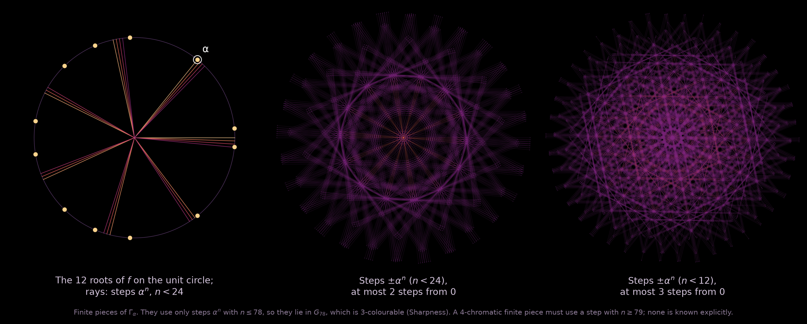
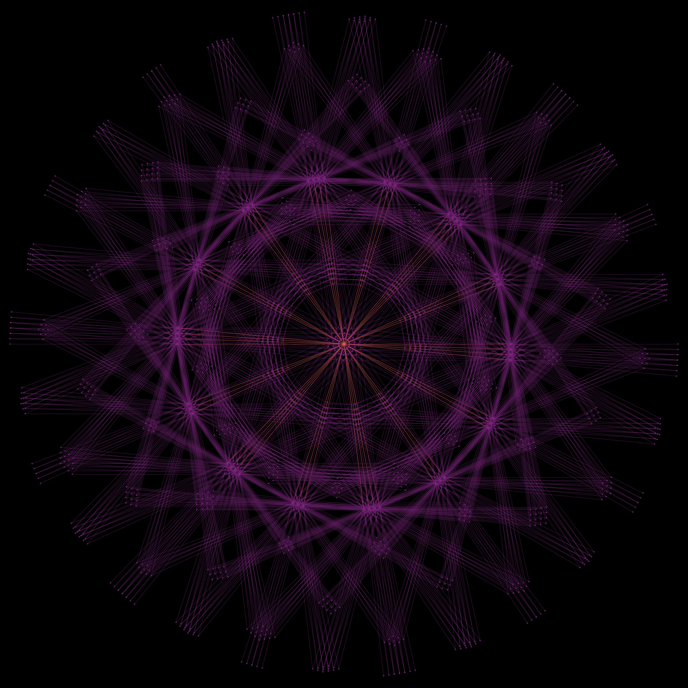
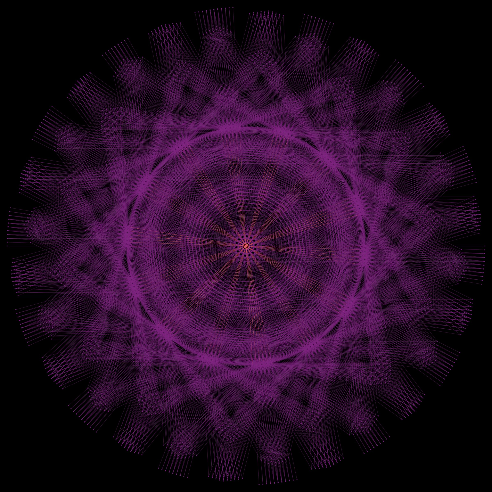

# Davidson's Conjecture 4.3 is false: a non-3-colourable monomial Cayley graph with an algebraic noninteger parameter



**Paper:** [`paper/counterexample.md`](paper/counterexample.md) · **Independent verification:** [`VERIFICATION.md`](VERIFICATION.md), [`REVIEW_GPT-6.2-Sol.md`](REVIEW_GPT-6.2-Sol.md), [`verification/astra/`](verification/astra/) · **Lean:** [`lean/`](lean/) · **Certificate:** [`certificate/`](certificate/)

## Result

For a unit complex number $\alpha$, $\Gamma_\alpha=\mathrm{Cay}(\mathbb Z[\alpha],\{\pm\alpha^n:n\ge0\})$ is a unit-distance graph in the plane. J. Davidson ([arXiv:2610.09474](https://arxiv.org/abs/2610.09474), Oct 2026) proved $\chi(\Gamma_\alpha)\le4$ for algebraic nonintegers $\alpha$, and conjectured that three colours always suffice (**Conjecture 4.3**).

> **Theorem.** For every root $\alpha$ of
> $$f(x)=2x^{12}+2x^{11}+x^{10}-x^{9}-2x^{8}-x^{7}-x^{6}-x^{5}-2x^{4}-x^{3}+x^{2}+2x+2$$
> (all twelve roots lie on the unit circle), $\chi(\Gamma_\alpha)=4$. Hence Conjecture 4.3 is false.

- $f$ satisfies every necessary condition for a counterexample that Davidson derived: Prop. 4.5, and degree at least $10$.
- **Proof.** Three-colourings of an abelian Cayley graph correspond to characters that put every generator in $[1/3,2/3]$. This criterion is due to [kooshi/hadwiger-nelson](https://github.com/kooshi/hadwiger-nelson), row 79, with a Lean proof of the direction we use. It reduces 3-colourability of the subgraph spanned by $1,\alpha,\dots,\alpha^{79}$ to finitely many linear programs.
- **Certificate.** An exact certificate shows that all of these programs are infeasible: 75,530 nodes with rational Farkas multipliers.
- **Sharpness.** The subgraph spanned by $1,\dots,\alpha^{78}$ is 3-colourable.
- **Lean.** The finite core is formalized in Lean 4 ([`lean/`](lean/)). This covers Proposition 3 in its exact form, the finite $K=78$ system behind sharpness, and the polynomial facts of §2. The checker's soundness is kernel-checked, and the certificate is accepted via `native_decide`. The three-colour criterion (Lemmas 1, 2, 2′) is not formalized here.

## Özet (Türkçe)

Davidson (Ekim 2026), birim karmaşık $\alpha$ için tanımlanan $\Gamma_\alpha$ birim-uzaklık graflarında, $\alpha$ cebirsel tamsayı değilse 3 rengin yeteceğini öne sürdü (Sanı 4.3).

Bu sanı yanlıştır. Yukarıdaki 12. dereceden $f$'nin her kökü için $\chi(\Gamma_\alpha)=4$ olur. Kanıt iki parçadan oluşur:

- **Ölçüt.** Üç renklendirmeyi karakterlerle ilişkilendiren ölçüt (Lean'de biçimselleştirilmiş).
- **Sertifika.** 75.530 düğümlü, kesin rasyonel sayılarla yazılmış bir sertifika.

İki bağımsız hakem sertifikayı baştan kontrol etti. GPT-6.2 Astra da kendi denetleyicisiyle bir kez daha doğruladı (`verification/astra/`). Sertifika (Önerme 3), K=78 keskinliği ve polinomla ilgili olgular ayrıca Lean 4'te doğrulandı (`lean/`).

## Pictures

The graph $\Gamma_\alpha$ is infinite, so it cannot be drawn whole. The figures in [`figures/`](figures/) show finite pieces of it for one root $\alpha\approx e^{0.893i}$ of $f$: all points within 2 or 3 unit steps $\pm\alpha^n$ of $0$, joined when they differ by one of these steps. They are illustrations, not part of the proof. Every piece shown uses only steps with $n\le 78$, so it lies in $G_{78}$ and is still 3-colourable. A 4-chromatic finite piece must use a step $\alpha^n$ with $n\ge 79$, and no explicit one is known. To regenerate: `python3 code/draw_figures.py` (needs `numpy`, `matplotlib`).

| | |
|---|---|
|  |  |

**Resimler (Türkçe).** $\Gamma_\alpha$ sonsuz olduğu için tamamı çizilemez. Görseller grafın sonlu parçalarıdır ve kanıtın parçası değildir. Çizilen parçaların hepsi hâlâ 3 renkle boyanabilir; 4 renk gerektiren sonlu bir parça mutlaka $n\ge 79$ olan bir $\alpha^n$ adımı içermelidir. Böyle bir parça henüz açıkça bilinmiyor; büyüklüğü hakkında da bir şey bilinmiyor.

## Verifying

```bash
cd certificate && gunzip -k proof_fB_L68.jsonl.gz && sha256sum -c SHA256SUMS --ignore-missing
cd .. && python3 code/check_proof.py "[2,2,1,-1,-2,-1,-1,-1,-2,-1,1,2,2]" 68 certificate/proof_fB_L68.jsonl
# -> proof OK ... => no valid word of length 68 with tau_0 > 0 exists   (about 1–3 minutes, pure Python fractions)
```

## How this was produced

- **Direction.** Efe Çam directed the work.
- **Search and certificate.** A Claude (Anthropic) agent, running in Claude Code, did the search, derived the criterion, and wrote the certificate generator and checker. It found the criterion independently; only afterwards did it learn that the criterion is already recorded, with a Lean proof, in kooshi/hadwiger-nelson. That work is credited throughout.
- **Verification.** A separate Claude instance refereed the claim from scratch and re-implemented the checks ([`VERIFICATION.md`](VERIFICATION.md)). GPT-6.2 Sol (OpenAI) refereed it independently and re-checked all 75,530 nodes in exact arithmetic ([`REVIEW_GPT-6.2-Sol.md`](REVIEW_GPT-6.2-Sol.md)).
- **Third check (GPT-6.2 Astra).** Working from commit `9f2a8de`, GPT-6.2 Astra did three things:
  - re-verified the polynomial facts symbolically;
  - rebuilt the $K=78$ witness;
  - re-checked all 75,530 certificate nodes with its own integer-arithmetic checker.

  The package and our re-run are in [`verification/astra/`](verification/astra/).
- **Lean.** A Claude (Opus 5.5) agent wrote the Lean 4 code. The coordinating Claude session then audited it:
  - compared each statement with the paper;
  - rebuilt everything from scratch;
  - regenerated the certificate data, with an identical hash;
  - ran tests showing that corrupted certificates are rejected.

  Details are in [`lean/README.md`](lean/README.md).

Errors are possible. Please open an issue if you find one.

## Citation / Atıf

```bibtex
@misc{cam2026davidson,
  author       = {{\c{C}}am, Efe},
  title        = {A counterexample to {D}avidson's {C}onjecture 4.3: a non-3-colourable monomial {C}ayley graph with an algebraic noninteger direction parameter},
  year         = {2026},
  month        = nov,
  howpublished = {\url{https://github.com/the-arma-of-owl/davidson-conjecture-4-3-counterexample}},
  note         = {Version 1}
}
```

The same metadata is in [`CITATION.cff`](CITATION.cff), which GitHub uses for its “Cite this repository” button. Atıf için bu BibTeX kaydını ya da GitHub'daki “Cite this repository” düğmesini kullanabilirsiniz.

## License

Text and data: CC BY 4.0. Code: MIT.
